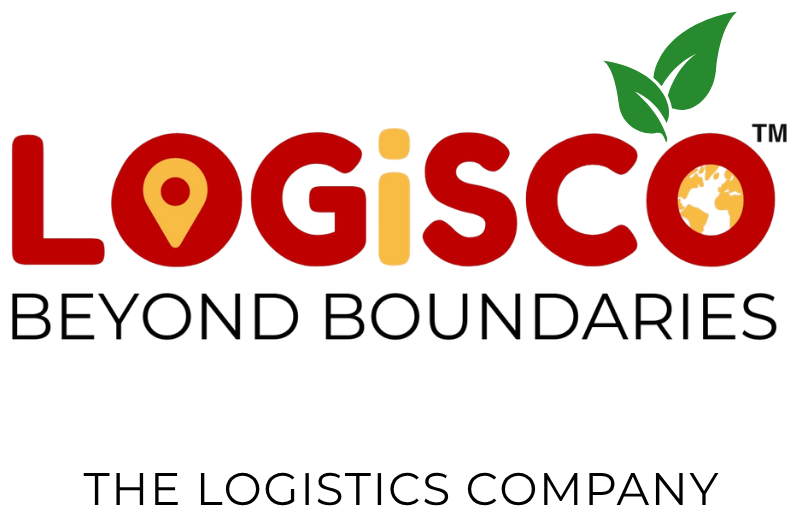
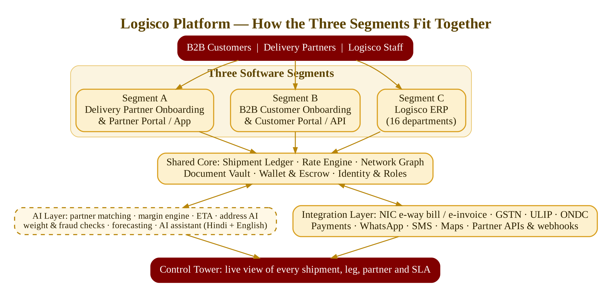
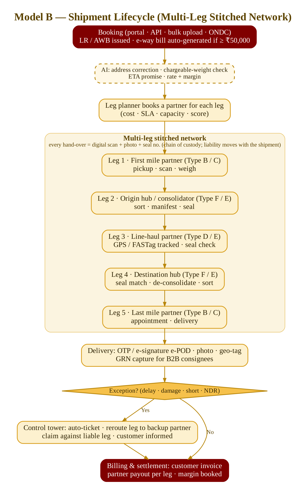
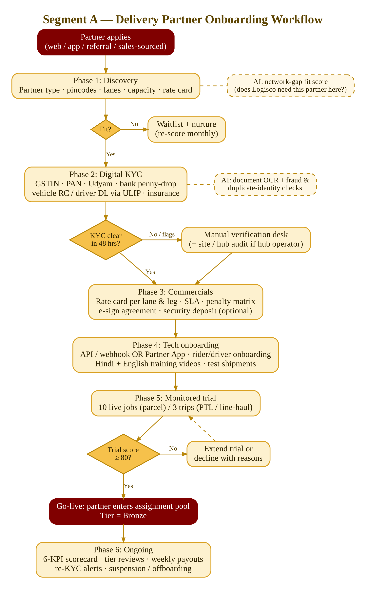
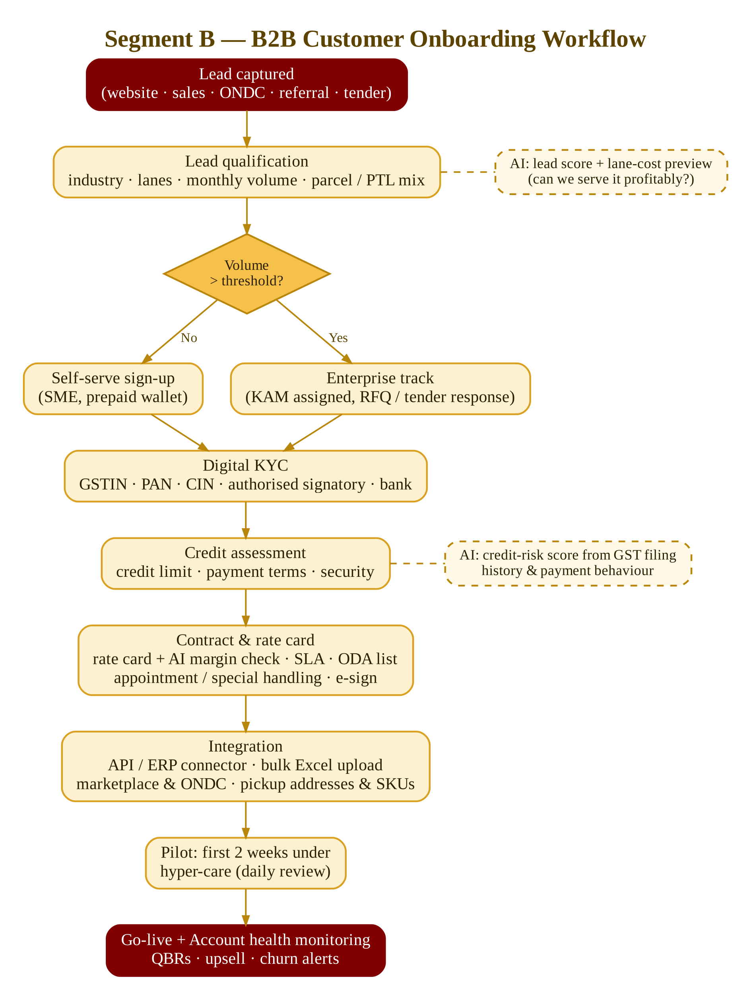
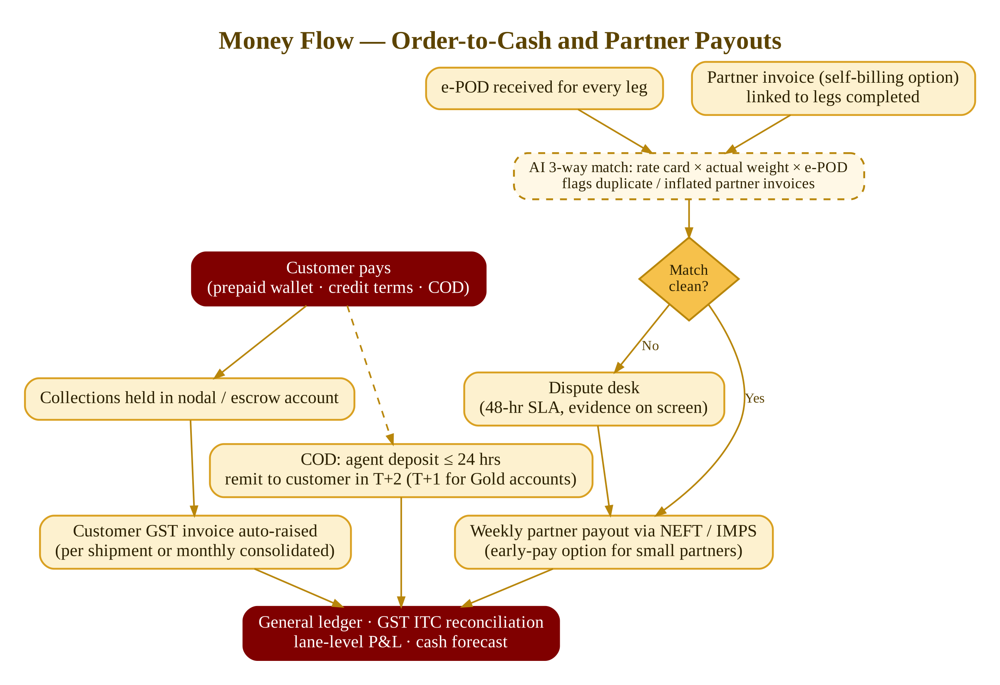
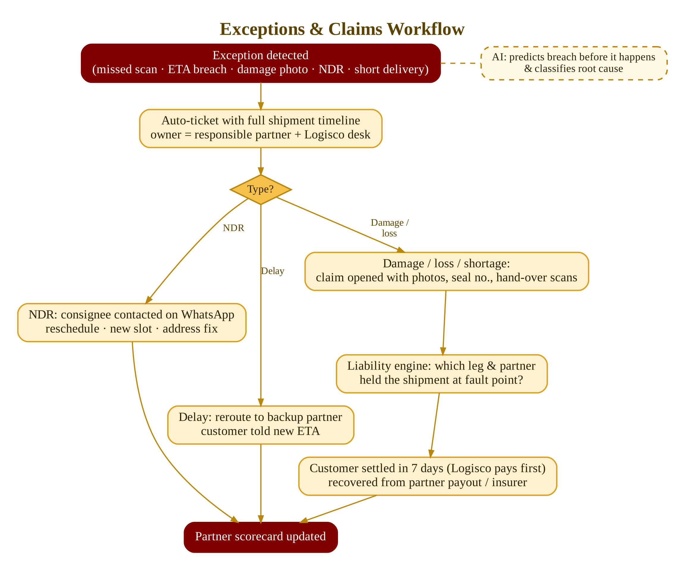
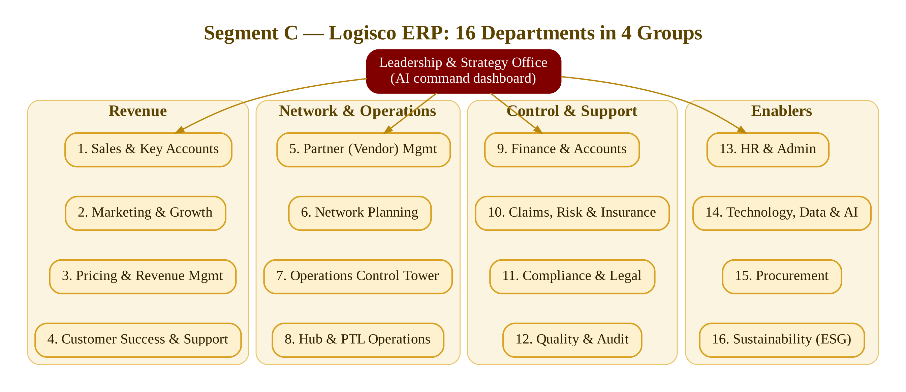

**AI-Enabled Parcel & PTL Platform**

Model B — Multi-Leg Stitched Network

Workflow Specification · Partner Onboarding · B2B Customer Onboarding · Logisco ERP

**Prepared for:** Logisco Global (India) Limited

**Business model:** Asset-light aggregator · B2B Parcel and PTL · Pan-India ·

Model B — Multi-Leg Stitched Network

**Classification:** Confidential — for internal and IT partner use

**Contents**

[1. Portal Architecture — Who Uses What [1](#portal-architecture-who-uses-what)](#portal-architecture-who-uses-what)

[Scope at a Glance [1](#scope-at-a-glance)](#scope-at-a-glance)

[2. Aggregator Model — How It Works [1](#aggregator-model-how-it-works)](#aggregator-model-how-it-works)

[2.1 Services on the Platform [1](#services-on-the-platform)](#services-on-the-platform)

[2.2 Network Model — Model B: Multi-Leg Stitched Network [1](#network-model-model-b-multi-leg-stitched-network)](#network-model-model-b-multi-leg-stitched-network)

[3. Delivery Partner (Vendor) Types [1](#delivery-partner-vendor-types)](#delivery-partner-vendor-types)

[4. Delivery Partner Onboarding Workflow [1](#delivery-partner-onboarding-workflow)](#delivery-partner-onboarding-workflow)

[Phase 1 — Discovery & Application [1](#phase-1-discovery-application)](#phase-1-discovery-application)

[Phase 2 — Document Submission & KYC Verification [1](#phase-2-document-submission-kyc-verification)](#phase-2-document-submission-kyc-verification)

[Phase 3 — Agreement Signing & Commercial Setup [1](#phase-3-agreement-signing-commercial-setup)](#phase-3-agreement-signing-commercial-setup)

[Phase 4 — Technical Integration & App Onboarding [1](#phase-4-technical-integration-app-onboarding)](#phase-4-technical-integration-app-onboarding)

[Phase 5 — Monitored Trial & Go-Live [1](#phase-5-monitored-trial-go-live)](#phase-5-monitored-trial-go-live)

[4.1 Document Checklist [1](#document-checklist)](#document-checklist)

[5. Post-Onboarding Partner Management [1](#post-onboarding-partner-management)](#post-onboarding-partner-management)

[5.1 Partner Dashboard — Daily Workflow [1](#partner-dashboard-daily-workflow)](#partner-dashboard-daily-workflow)

[5.2 Partner Performance Scorecard (Visible to the Partner) [1](#partner-performance-scorecard-visible-to-the-partner)](#partner-performance-scorecard-visible-to-the-partner)

[5.3 Vendor Tier System & Consequence Framework [1](#vendor-tier-system-consequence-framework)](#vendor-tier-system-consequence-framework)

[5.4 Vendor Suspension & Offboarding Protocol [1](#vendor-suspension-offboarding-protocol)](#vendor-suspension-offboarding-protocol)

[6. B2B Customer Onboarding Workflow [1](#b2b-customer-onboarding-workflow)](#b2b-customer-onboarding-workflow)

[Phase 1 — Lead & Qualification [1](#phase-1-lead-qualification)](#phase-1-lead-qualification)

[Phase 2 — KYC & Credit [1](#phase-2-kyc-credit)](#phase-2-kyc-credit)

[Phase 3 — Contract & Rate Card [1](#phase-3-contract-rate-card)](#phase-3-contract-rate-card)

[Phase 4 — Integration & Go-Live [1](#phase-4-integration-go-live)](#phase-4-integration-go-live)

[7. Shipment Booking Workflow (Parcel & PTL) [1](#shipment-booking-workflow-parcel-ptl)](#shipment-booking-workflow-parcel-ptl)

[7.1 Shipment Status Track Shown to Customer [1](#shipment-status-track-shown-to-customer)](#shipment-status-track-shown-to-customer)

[7.2 Business Account — Customer Portal Features [1](#business-account-customer-portal-features)](#business-account-customer-portal-features)

[8. Smart Partner Assignment & Pricing Engine [1](#smart-partner-assignment-pricing-engine)](#smart-partner-assignment-pricing-engine)

[8.1 Price Build-Up [1](#price-build-up)](#price-build-up)

[9. Finance & Commission Workflow [1](#finance-commission-workflow)](#finance-commission-workflow)

[10. Exceptions & Claims Workflow [1](#exceptions-claims-workflow)](#exceptions-claims-workflow)

[11. Logisco ERP — Departments [1](#logisco-erp-departments)](#logisco-erp-departments)

[11.1 Operations Control Tower — Features [1](#operations-control-tower-features)](#operations-control-tower-features)

[12. AI Features by Segment [1](#ai-features-by-segment)](#ai-features-by-segment)

[13. Technology Integration Requirements [1](#technology-integration-requirements)](#technology-integration-requirements)

[14. Language, Compliance & Security [1](#language-compliance-security)](#language-compliance-security)

# 1. Portal Architecture — Who Uses What

Logisco's platform is built in three segments that share one backend. A status update made in the Partner App instantly reflects in the Customer Portal, the Control Tower and the Finance ledger.

| **Segment** | **Who Uses It** | **Core Purpose** |
|---|---|---|
| A. Delivery Partner Portal + App | Courier companies, transporters, hub operators, riders, drivers | Onboard, accept jobs, scan hand-overs, capture e-POD, view score and payouts |
| B. Customer Portal + API | B2B shippers: SMEs, manufacturers, distributors, brands, enterprises | Onboard, get quotes, book Parcel / PTL, track, pay, download documents |
| C. Logisco ERP + Control Tower | Logisco staff across 16 departments | Run sales, pricing, network, operations, finance, claims, compliance, HR, tech |

*Figure 1. How the three segments fit together*

## Scope at a Glance

| **Item** | **Decision** |
|---|---|
| Services | B2B Express Parcel and PTL only (Packing & Moving and FTL stay separate products) |
| Customers | B2B only — no B2C or individuals |
| Asset model | Asset-light — no own fleet, no own hubs; partners run hubs; Logisco runs a virtual control tower |
| Network | Model B — multi-leg stitched network: separate partners for first mile, hub, line-haul and last mile, stitched by Logisco |
| Pricing | Rate card + AI margin engine in Phase 1; dynamic pricing in Phase 2 |
| Money | Logisco collects all money (escrow / nodal), handles COD, gives credit terms to large customers |
| Languages | English + Hindi in every app, portal, WhatsApp message and AI assistant |

# 2. Aggregator Model — How It Works

Logisco does not own any delivery fleet or hub. It is the technology, brand, pricing and service-promise layer that connects B2B customers to verified delivery partners for first mile, mid mile and last mile.

| **Entity** | **Role in the Ecosystem** |
|---|---|
| Logisco | Technology owner, brand owner, pricing engine, customer interface, control tower, money collector; earns the margin between customer price and partner cost |
| B2B Customer (Shipper) | Books Parcel / PTL shipments, pays Logisco, gets one tracking number and one invoice however many partners touch the shipment |
| Consignee (Receiver) | Receives goods, books delivery appointment, signs e-POD, records short or damaged pieces — no app needed |
| Delivery Partner Company | Executes one leg (pickup, hub handling, line-haul or delivery) under a Logisco rate card and SLA |
| Partner Field Staff | Riders, drivers and hub staff who scan, load, move and deliver using the Logisco Partner App |

## 2.1 Services on the Platform

| **Service** | **Detail** |
|---|---|
| B2B Express Parcel | Boxes ~0.5–30 kg · priced by weight slab × zone · chargeable weight = higher of actual and volumetric · Economy / Standard / Express |
| Express PTL | Multi-box consignments ~20 kg to a few tonnes · per kg with minimum chargeable weight and CFT factor · assured delivery date |
| Standard PTL | Bulk B2B consignments where cost matters more than speed · per kg with minimum chargeable weight |
| Value-Added Services | Appointment delivery · ODA delivery · multi-piece · reverse pickup · COD · To-Pay · transit insurance · special handling |
| Freight Payment Modes | Paid (at booking) · To-Pay (consignee pays) · TBB / To-Be-Billed (credit) · COD (value of goods collected) |

## 2.2 Network Model — Model B: Multi-Leg Stitched Network

| **Parameter** | **Detail** |
|---|---|
| How it works | Logisco books a separate partner for each leg: first mile → origin hub → line-haul → destination hub → last mile, and stitches them into one shipment |
| Partners used | Type B / C for first and last mile · Type D / E for line-haul · Type F / E for hubs · Type A for any single leg |
| Best for | Coverage gaps, Tier-2/3 and ODA pincodes, express PTL lanes, cost-sensitive volume |
| Logisco earns | Margin between customer price and the sum of leg costs (higher than Model A) |
| Logisco controls | Route design, every hand-over, hub flows, line-haul tracking, exceptions, claims, billing and payouts per leg |
| Key software need | Leg planning, hand-over scans, seals, manifests, per-leg billing and liability |

<table>
<colgroup>
<col style="width: 100%" />
</colgroup>
<thead>
<tr class="header">
<th>
<strong>Design Rule</strong>

Every shipment is stored as one <strong>master shipment</strong> with <strong>2–5 legs</strong>. Each hand-over is a digital scan with photo and seal number, so liability moves with the shipment. Billing, tracking, claims and partner scoring all work on legs.
</th>
</tr>
</thead>
<tbody>
</tbody>
</table>

*Figure 2. Model B shipment lifecycle*

# 3. Delivery Partner (Vendor) Types

Model B uses six partner categories, each serving one or more legs.

| **Vendor Type** | **Description & Eligibility** |
|---|---|
| Type A — National Courier Partner | PAN-India courier / express carriers. Used for any single leg (e.g. line-haul on a busy lane). Integrated via API. Paid per leg. |
| Type B — Regional / City-Level Courier | State or cluster couriers, strong in Tier-2 and Tier-3. First mile and last mile. Partner App or API. Paid per shipment handled. |
| Type C — Hyperlocal Delivery Partner | Single-city last-mile fleets, gig-enabled. Last mile and same-city pickups. Partner App. Paid per delivery / drop. |
| Type D — Mid-Mile / Line-Haul Transporter | Truck owners and fleet operators running fixed lanes hub-to-hub. Partner App + GPS / FASTag via ULIP. Paid per trip or per kg on the lane. |
| Type E — PTL Consolidator / Transporter | Transport companies running PTL lanes. Consolidation and PTL line-haul legs, and hub handling where they have hubs. Partner Portal + API. Paid per kg with minimum chargeable weight. |
| Type F — Hub / Warehouse Operator | Owners of cross-dock or warehouse space. Sorting, consolidation, de-consolidation, short storage. Hub scanning app. Paid per piece / kg handled + storage per day. |

# 4. Delivery Partner Onboarding Workflow

Target: application to go-live in about 5 business days, plus a monitored trial. Variations by partner type are noted inside each step.

*Figure 3. Delivery partner onboarding workflow*

## Phase 1 — Discovery & Application

<table>
<colgroup>
<col style="width: 11%" />
<col style="width: 88%" />
</colgroup>
<thead>
<tr class="header">
<th>
<strong>STEP</strong>

<strong>1</strong>
</th>
<th>
<strong>Partner Applies on the Partner Registration Portal</strong>

<ul>
<li>
Partner applies via website, app, referral or Logisco sales team
</li>
<li>
Selects partner type (A–F) and the legs it can serve; fills: company name, GSTIN, PAN, operating states / cities, serviceable pincodes or lanes, hubs, fleet size, daily capacity, indicative rates
</li>
<li>
System runs duplicate check on GSTIN / PAN / phone and shows a pincode map preview of coverage
</li>
<li>
Auto-acknowledgement with Application Reference Number on WhatsApp and email
</li>
</ul></th>
</tr>
</thead>
<tbody>
</tbody>
</table>

<table>
<colgroup>
<col style="width: 11%" />
<col style="width: 88%" />
</colgroup>
<thead>
<tr class="header">
<th>
<strong>STEP</strong>

<strong>2</strong>
</th>
<th>
<strong>AI Network-Gap Fit Score (Target: Same Day)</strong>

<ul>
<li>
AI checks whether Logisco needs this partner for these legs, pincodes or lanes
</li>
<li>
Fit → partner receives the onboarding pack and an Onboarding Coordinator is assigned
</li>
<li>
No fit → partner goes to a waitlist and is re-scored monthly
</li>
</ul></th>
</tr>
</thead>
<tbody>
</tbody>
</table>

## Phase 2 — Document Submission & KYC Verification

<table>
<colgroup>
<col style="width: 11%" />
<col style="width: 88%" />
</colgroup>
<thead>
<tr class="header">
<th>
<strong>STEP</strong>

<strong>3</strong>
</th>
<th>
<strong>Digital KYC (Target: Within 48 Hours)</strong>

<ul>
<li>
Fetch / upload: GSTIN, PAN, Udyam (if MSME), cancelled cheque, insurance, transport licence
</li>
<li>
Type C / D / E: vehicle RC and driver licence checked via ULIP (Vahan, Sarathi); DigiLocker fetch where possible
</li>
<li>
GSTIN and PAN verified by API; bank penny-drop triggered automatically
</li>
<li>
AI document OCR flags tampered, duplicate or mismatched documents
</li>
</ul></th>
</tr>
</thead>
<tbody>
</tbody>
</table>

<table>
<colgroup>
<col style="width: 11%" />
<col style="width: 88%" />
</colgroup>
<thead>
<tr class="header">
<th>
<strong>STEP</strong>

<strong>4</strong>
</th>
<th>
<strong>Manual Verification Desk + Hub Audit (Only if Flagged / Hub Operators)</strong>

<ul>
<li>
Flagged cases reviewed manually by the Partner Management team
</li>
<li>
Type F (and Type E with a hub): site audit with geo-tagged photos — security, CCTV, fire safety, docks, scale calibration (within 5 days)
</li>
<li>
Outcome: Approved / Conditionally Approved / Rejected with reasons
</li>
</ul></th>
</tr>
</thead>
<tbody>
</tbody>
</table>

## Phase 3 — Agreement Signing & Commercial Setup

<table>
<colgroup>
<col style="width: 11%" />
<col style="width: 88%" />
</colgroup>
<thead>
<tr class="header">
<th>
<strong>STEP</strong>

<strong>5</strong>
</th>
<th>
<strong>Rate Card, SLA and Agreement (1–3 Days)</strong>

<ul>
<li>
Agree rate card per leg and lane, hand-over windows and cut-off times, SLA, penalty matrix, liability cap, payment cycle; optional security deposit
</li>
<li>
AI margin check flags lanes where the partner rate leaves Logisco below target margin
</li>
<li>
Agreement generated from template and e-signed; rate card loaded into the rate engine
</li>
</ul></th>
</tr>
</thead>
<tbody>
</tbody>
</table>

## Phase 4 — Technical Integration & App Onboarding

<table>
<colgroup>
<col style="width: 11%" />
<col style="width: 88%" />
</colgroup>
<thead>
<tr class="header">
<th>
<strong>STEP</strong>

<strong>6</strong>
</th>
<th>
<strong>Connect Systems and Onboard Field Staff (1–2 Days)</strong>

<ul>
<li>
Type A / E: API / webhook integration tested in sandbox with test shipments
</li>
<li>
Other types: install Logisco Partner App; add riders, drivers and hub staff with photo and ID
</li>
<li>
Training videos and practice mode for scan, hand-over, seal and e-POD — in Hindi and English
</li>
<li>
AI assistant answers 'how do I…' questions inside the app
</li>
</ul></th>
</tr>
</thead>
<tbody>
</tbody>
</table>

## Phase 5 — Monitored Trial & Go-Live

<table>
<colgroup>
<col style="width: 11%" />
<col style="width: 88%" />
</colgroup>
<thead>
<tr class="header">
<th>
<strong>STEP</strong>

<strong>7</strong>
</th>
<th>
<strong>Monitored Trial (1–2 Weeks)</strong>

<ul>
<li>
10 live parcel jobs, or 3 PTL / line-haul trips, under close watch
</li>
<li>
Each job scored; AI flags anomalies in scans, weights and timings
</li>
<li>
Trial score ≥ 80 → go-live; below 80 → trial extended or partner declined with reasons
</li>
</ul></th>
</tr>
</thead>
<tbody>
</tbody>
</table>

<table>
<colgroup>
<col style="width: 11%" />
<col style="width: 88%" />
</colgroup>
<thead>
<tr class="header">
<th>
<strong>STEP</strong>

<strong>8</strong>
</th>
<th>
<strong>Go-Live and Ongoing Management</strong>

<ul>
<li>
Partner enters the assignment pool at Bronze tier
</li>
<li>
Weekly scorecard, tier reviews, weekly payouts, document-expiry and re-KYC alerts
</li>
</ul></th>
</tr>
</thead>
<tbody>
</tbody>
</table>

## 4.1 Document Checklist

| **Document** | **A** | **B** | **C** | **D** | **E** | **F** |
|---|---|---|---|---|---|---|
| GST registration (GSTIN) | ✓ | ✓ | ✓¹ | ✓¹ | ✓ | ✓ |
| PAN (company or proprietor) | ✓ | ✓ | ✓ | ✓ | ✓ | ✓ |
| Bank account (penny-drop verified) | ✓ | ✓ | ✓ | ✓ | ✓ | ✓ |
| Incorporation certificate / partnership deed | ✓ | ✓ | ✓² | ✓² | ✓ | ✓ |
| Udyam (MSME) certificate | Opt. | Opt. | Opt. | Opt. | Opt. | Opt. |
| Goods-in-transit / liability insurance | ✓ | ✓ | Opt. | ✓ | ✓ | ✓³ |
| Vehicle RC, fitness, permit, insurance | — | ✓⁴ | ✓ | ✓ | ✓ | — |
| Driver / rider licence and ID | — | ✓ | ✓ | ✓ | ✓ | — |
| Police verification of field staff | — | ✓ | ✓ | ✓ | ✓ | ✓ |
| Hub lease, fire NOC, trade licence | — | ✓⁵ | — | — | ✓⁵ | ✓ |
| Signed agreement, SLA, rate card | ✓ | ✓ | ✓ | ✓ | ✓ | ✓ |

¹ if GST-registered · ² if a company or firm · ³ premises insurance · ⁴ if own fleet · ⁵ if the partner runs a hub · Opt. = optional

# 5. Post-Onboarding Partner Management

## 5.1 Partner Dashboard — Daily Workflow

| **Action** | **How It Works** |
|---|---|
| Receive Jobs | Pickups, line-haul trips, hub tasks and deliveries appear automatically with SLA clocks; partner accepts or flags non-serviceability |
| Declare Capacity | Partner sets daily capacity and holidays in the capacity calendar; the assignment engine respects it |
| Assign to Field Staff | Partner admin assigns jobs to riders / drivers; they get them in the Partner App |
| Pickup | Scan pieces, photo of weight and dimensions, attach label, collect invoice copy; status → Picked Up |
| Hand-Over | Scan out to the next partner with seal number and vehicle number; both sides confirm (chain of custody) |
| Line-Haul Trip | Start trip, GPS / FASTag tracking, report halts or breakdowns, arrival with seal check |
| Hub Operations | Bulk in-scan, sort to destination bags / cages, manifest, out-scan, seal |
| Delivery | Masked call to consignee, appointment check, OTP / signature, photo, geo-tag, short / damaged pieces, COD collection |
| NDR | Reason code + photo of location; action follows customer's choice |
| Escalations | Tickets land in the partner's inbox with a response timer; missed timer reduces score |
| Daily Reconciliation | Legs completed, COD collected, deductions with evidence, payout status — in the partner finance panel |

The Partner App works offline in low-network areas, syncs when connected, runs on low-cost Android phones, and has Hindi voice prompts and an SOS button.

## 5.2 Partner Performance Scorecard (Visible to the Partner)

| **Performance Parameter** | **Weightage (Parcel / PTL & Line-Haul) and Measure** |
|---|---|
| Pickup Adherence | 15% / 15% — picked up within the promised window |
| On-Time Delivery / Arrival | 25% / 30% — delivered or arrived at hub by promised time |
| First-Attempt / Appointment Success | 15% / 10% — delivered on first attempt or within booked slot |
| Damage, Loss & Shortage | 20% / 25% — claims per 10,000 pieces attributed to this partner's leg |
| Scan & e-POD Compliance | 15% / 10% — every hand-over scanned with photo and seal; e-POD complete |
| Responsiveness | 10% / 10% — tickets acknowledged and resolved within SLA |

## 5.3 Vendor Tier System & Consequence Framework

| **Tier (Score)** | **Partner Gets** | **If Score Falls** |
|---|---|---|
| Platinum (≥ 90) | First choice in assignment · payout in 3 days · volume commitments · co-branding | Down one tier after 2 weeks below band |
| Gold (80–89) | Priority assignment · weekly payout · early-pay option | Improvement plan |
| Silver (70–79) | Normal assignment · weekly payout · early-pay option | Warning and coaching |
| Bronze (60–69; all new partners) | Capped volume · fortnightly payout | Volume cut by 50% |
| Probation (\< 60) | Essential allocations only | Suspension review after 2 weeks; offboarding if no recovery |

## 5.4 Vendor Suspension & Offboarding Protocol

<table>
<colgroup>
<col style="width: 11%" />
<col style="width: 88%" />
</colgroup>
<thead>
<tr class="header">
<th>
<strong>STEP</strong>

<strong>1</strong>
</th>
<th>
<strong>Trigger</strong>

<ul>
<li>
Score below 60 for 2 weeks, fraud / theft / tampering, repeated document expiry, or partner request
</li>
</ul></th>
</tr>
</thead>
<tbody>
</tbody>
</table>

<table>
<colgroup>
<col style="width: 11%" />
<col style="width: 88%" />
</colgroup>
<thead>
<tr class="header">
<th>
<strong>STEP</strong>

<strong>2</strong>
</th>
<th>
<strong>Freeze and Transfer</strong>

<ul>
<li>
Freeze new allocations; finish or transfer in-flight shipments to backup partners
</li>
</ul></th>
</tr>
</thead>
<tbody>
</tbody>
</table>

<table>
<colgroup>
<col style="width: 11%" />
<col style="width: 88%" />
</colgroup>
<thead>
<tr class="header">
<th>
<strong>STEP</strong>

<strong>3</strong>
</th>
<th>
<strong>Settle and Close</strong>

<ul>
<li>
Settle claims and deductions with evidence → final payout → revoke app and API access → archive records per retention policy
</li>
<li>
Every step logged with reasons and visible to the partner
</li>
</ul></th>
</tr>
</thead>
<tbody>
</tbody>
</table>

# 6. B2B Customer Onboarding Workflow

| **Customer Type** | **Onboarding Track & Billing** |
|---|---|
| SME Shipper | Self-serve, same day · prepaid wallet; small credit limit after 3 months of good history |
| Manufacturer / Distributor | Assisted by inside sales · credit (TBB) with limit |
| Brand with Retail / Modern Trade | Key Account Manager · credit, monthly invoice; appointment deliveries |
| Enterprise | KAM + solutions team, RFQ / tender · contract with credit terms, ERP integration |
| Marketplace / ONDC B2B Seller | API / ONDC self-serve · prepaid or credit |

*Figure 4. B2B customer onboarding workflow*

## Phase 1 — Lead & Qualification

<table>
<colgroup>
<col style="width: 11%" />
<col style="width: 88%" />
</colgroup>
<thead>
<tr class="header">
<th>
<strong>STEP</strong>

<strong>1</strong>
</th>
<th>
<strong>Lead Captured (Instant)</strong>

<ul>
<li>
Sources: website form, sales visit, referral, ONDC, tender, partner referral
</li>
<li>
Lead created in CRM with source; duplicate check by GSTIN
</li>
<li>
AI lead score from industry, lanes and declared volume
</li>
</ul></th>
</tr>
</thead>
<tbody>
</tbody>
</table>

<table>
<colgroup>
<col style="width: 11%" />
<col style="width: 88%" />
</colgroup>
<thead>
<tr class="header">
<th>
<strong>STEP</strong>

<strong>2</strong>
</th>
<th>
<strong>Qualification (Same Day)</strong>

<ul>
<li>
Capture monthly volume, Parcel / PTL mix, top lanes, special handling, payment preference
</li>
<li>
AI lane-cost preview: can Logisco serve these lanes profitably?
</li>
<li>
Volume above threshold → Enterprise track (KAM assigned); otherwise → self-serve SME track
</li>
</ul></th>
</tr>
</thead>
<tbody>
</tbody>
</table>

## Phase 2 — KYC & Credit

<table>
<colgroup>
<col style="width: 11%" />
<col style="width: 88%" />
</colgroup>
<thead>
<tr class="header">
<th>
<strong>STEP</strong>

<strong>3</strong>
</th>
<th>
<strong>Digital KYC (≤ 1 Hour for Self-Serve)</strong>

<ul>
<li>
GSTIN, PAN, CIN (if company), authorised signatory, bank account, pickup addresses
</li>
<li>
GSTIN / PAN verified by API; bank penny-drop; AI address correction pins pickup points
</li>
</ul></th>
</tr>
</thead>
<tbody>
</tbody>
</table>

<table>
<colgroup>
<col style="width: 11%" />
<col style="width: 88%" />
</colgroup>
<thead>
<tr class="header">
<th>
<strong>STEP</strong>

<strong>4</strong>
</th>
<th>
<strong>Credit Assessment (1–2 Days, Credit Customers Only)</strong>

<ul>
<li>
AI credit-risk score from GST filing regularity, business age and payment behaviour
</li>
<li>
Credit limit, payment terms, security deposit / bank guarantee rules set
</li>
</ul></th>
</tr>
</thead>
<tbody>
</tbody>
</table>

## Phase 3 — Contract & Rate Card

<table>
<colgroup>
<col style="width: 11%" />
<col style="width: 88%" />
</colgroup>
<thead>
<tr class="header">
<th>
<strong>STEP</strong>

<strong>5</strong>
</th>
<th>
<strong>Rate Card, SLA and Contract (1–3 Days)</strong>

<ul>
<li>
Standard or negotiated rate card; SLA; ODA list; appointment rules; liability and insurance terms
</li>
<li>
AI margin engine checks every rate line against partner costs and target margin
</li>
<li>
Contract generated and e-signed
</li>
</ul></th>
</tr>
</thead>
<tbody>
</tbody>
</table>

## Phase 4 — Integration & Go-Live

<table>
<colgroup>
<col style="width: 11%" />
<col style="width: 88%" />
</colgroup>
<thead>
<tr class="header">
<th>
<strong>STEP</strong>

<strong>6</strong>
</th>
<th>
<strong>System Integration (1–5 Days)</strong>

<ul>
<li>
API keys, ERP connector (Tally / SAP / Zoho), Excel template, marketplace or ONDC link
</li>
<li>
SKU master uploaded with dimensions → weight freeze; AI flags dimension outliers
</li>
</ul></th>
</tr>
</thead>
<tbody>
</tbody>
</table>

<table>
<colgroup>
<col style="width: 11%" />
<col style="width: 88%" />
</colgroup>
<thead>
<tr class="header">
<th>
<strong>STEP</strong>

<strong>7</strong>
</th>
<th>
<strong>Pilot under Hyper-Care (2 Weeks)</strong>

<ul>
<li>
Every shipment monitored daily; daily pilot report to KAM and customer; early warning on SLA risk
</li>
</ul></th>
</tr>
</thead>
<tbody>
</tbody>
</table>

<table>
<colgroup>
<col style="width: 11%" />
<col style="width: 88%" />
</colgroup>
<thead>
<tr class="header">
<th>
<strong>STEP</strong>

<strong>8</strong>
</th>
<th>
<strong>Go-Live and Account Health</strong>

<ul>
<li>
Normal operations; quarterly business reviews
</li>
<li>
AI churn-risk alerts and upsell suggestions (new lanes, Parcel / PTL mix)
</li>
</ul></th>
</tr>
</thead>
<tbody>
</tbody>
</table>

# 7. Shipment Booking Workflow (Parcel & PTL)

<table>
<colgroup>
<col style="width: 11%" />
<col style="width: 88%" />
</colgroup>
<thead>
<tr class="header">
<th>
<strong>STEP</strong>

<strong>1</strong>
</th>
<th>
<strong>Get Quote</strong>

<ul>
<li>
Customer enters origin, destination, pieces, weight, dimensions, value, service tier, add-ons
</li>
<li>
System checks serviceability and ODA; calculates chargeable weight
</li>
<li>
All-in price shown up front: freight + ODA + docket + appointment + fuel + insurance + GST — no surprises later
</li>
<li>
AI gives ETA promise and checks Logisco margin
</li>
</ul></th>
</tr>
</thead>
<tbody>
</tbody>
</table>

<table>
<colgroup>
<col style="width: 11%" />
<col style="width: 88%" />
</colgroup>
<thead>
<tr class="header">
<th>
<strong>STEP</strong>

<strong>2</strong>
</th>
<th>
<strong>Book</strong>

<ul>
<li>
Booking via portal, API, Excel bulk upload or ONDC
</li>
<li>
LR / AWB number and QR label generated; customer invoice copy stored
</li>
<li>
E-way bill auto-generated when value ≥ ₹50,000 (inter-state) or the state threshold
</li>
</ul></th>
</tr>
</thead>
<tbody>
</tbody>
</table>

<table>
<colgroup>
<col style="width: 11%" />
<col style="width: 88%" />
</colgroup>
<thead>
<tr class="header">
<th>
<strong>STEP</strong>

<strong>3</strong>
</th>
<th>
<strong>Route and Assign Partners</strong>

<ul>
<li>
Leg planner books a partner for each leg: first mile, origin hub, line-haul, destination hub, last mile (see Section 8)
</li>
<li>
Hand-over windows aligned across legs; ops can override from the Control Tower
</li>
</ul></th>
</tr>
</thead>
<tbody>
</tbody>
</table>

<table>
<colgroup>
<col style="width: 11%" />
<col style="width: 88%" />
</colgroup>
<thead>
<tr class="header">
<th>
<strong>STEP</strong>

<strong>4</strong>
</th>
<th>
<strong>Pickup + Weight Verification</strong>

<ul>
<li>
First-mile partner scans pieces and photographs weight and dimensions; status → Picked Up
</li>
<li>
If different from booked: customer notified with Accept Revised Rate OR Raise Dispute (evidence on screen)
</li>
</ul></th>
</tr>
</thead>
<tbody>
</tbody>
</table>

<table>
<colgroup>
<col style="width: 11%" />
<col style="width: 88%" />
</colgroup>
<thead>
<tr class="header">
<th>
<strong>STEP</strong>

<strong>5</strong>
</th>
<th>
<strong>Origin Hub — Hand-Over 1</strong>

<ul>
<li>
Sort, consolidate, manifest; bag / cage scan; seal number recorded; status → At Origin Hub
</li>
</ul></th>
</tr>
</thead>
<tbody>
</tbody>
</table>

<table>
<colgroup>
<col style="width: 11%" />
<col style="width: 88%" />
</colgroup>
<thead>
<tr class="header">
<th>
<strong>STEP</strong>

<strong>6</strong>
</th>
<th>
<strong>Line-Haul — Hand-Over 2</strong>

<ul>
<li>
GPS / FASTag tracking; e-way bill Part B updated on vehicle change; AI predicts delay; status → In Transit
</li>
</ul></th>
</tr>
</thead>
<tbody>
</tbody>
</table>

<table>
<colgroup>
<col style="width: 11%" />
<col style="width: 88%" />
</colgroup>
<thead>
<tr class="header">
<th>
<strong>STEP</strong>

<strong>7</strong>
</th>
<th>
<strong>Destination Hub — Hand-Over 3</strong>

<ul>
<li>
Seal check; de-consolidate; short / excess pieces flagged instantly; status → At Destination Hub
</li>
</ul></th>
</tr>
</thead>
<tbody>
</tbody>
</table>

<table>
<colgroup>
<col style="width: 11%" />
<col style="width: 88%" />
</colgroup>
<thead>
<tr class="header">
<th>
<strong>STEP</strong>

<strong>8</strong>
</th>
<th>
<strong>Appointment / Out for Delivery</strong>

<ul>
<li>
Consignee books slot on WhatsApp (DCs, modern trade) and uploads gate pass; reminders to last-mile partner
</li>
<li>
Others get a delivery window with masked agent contact
</li>
</ul></th>
</tr>
</thead>
<tbody>
</tbody>
</table>

<table>
<colgroup>
<col style="width: 11%" />
<col style="width: 88%" />
</colgroup>
<thead>
<tr class="header">
<th>
<strong>STEP</strong>

<strong>9</strong>
</th>
<th>
<strong>Delivery + e-POD</strong>

<ul>
<li>
OTP or e-signature, photo, geo-tag; GRN number captured
</li>
<li>
Piece-level short / damage recorded with photos; COD collected
</li>
<li>
Status → Delivered (or Delivered with Exception)
</li>
</ul></th>
</tr>
</thead>
<tbody>
</tbody>
</table>

<table>
<colgroup>
<col style="width: 11%" />
<col style="width: 88%" />
</colgroup>
<thead>
<tr class="header">
<th>
<strong>STEP</strong>

<strong>10</strong>
</th>
<th>
<strong>Exceptions / NDR</strong>

<ul>
<li>
Auto-ticket; WhatsApp buttons for consignee and shipper: Reattempt · Change Slot / Address · RTO
</li>
<li>
Delay → reroute to backup partner; damage / loss → claim (Section 10)
</li>
</ul></th>
</tr>
</thead>
<tbody>
</tbody>
</table>

<table>
<colgroup>
<col style="width: 11%" />
<col style="width: 88%" />
</colgroup>
<thead>
<tr class="header">
<th>
<strong>STEP</strong>

<strong>11</strong>
</th>
<th>
<strong>Billing</strong>

<ul>
<li>
GST invoice per shipment or monthly, with e-POD attached; COD remittance; partner payout per leg
</li>
</ul></th>
</tr>
</thead>
<tbody>
</tbody>
</table>

## 7.1 Shipment Status Track Shown to Customer

| **Booked** | **Picked Up** | **At Origin Hub** | **In Transit** | **At Dest. Hub** | **Out for Delivery** | **Delivered** |
|---|---|---|---|---|---|---|

Exception statuses: Undelivered (NDR) · Delivered with Exception · Return to Origin. Every partner status code is mapped to this one list.

## 7.2 Business Account — Customer Portal Features

| **Feature** | **Detail** |
|---|---|
| Dashboard | Shipments by status, SLA performance, exceptions needing action, spend this month, COD due |
| Bulk Booking | Excel upload, multi-piece booking, saved consignees and SKU dimensions, repeat booking |
| Universal Search | Find by LR, AWB, invoice no., PO no. or consignee; map view; full scan timeline |
| Branded Tracking | Tracking page with Logisco and the customer's brand for their consignees |
| Document Centre | LR, label, e-way bill, invoices, e-POD, GRN, photos — one ZIP per shipment or month |
| Exception Queue | Shipments on hold needing customer input, NDR actions, weight disputes, claims |
| Billing & COD | Wallet, credit limit, invoices, credit notes, payment links, ledger, COD remittance report |
| Analytics | Lane-wise transit time, on-time %, damage rate, cost per kg, CO2 per shipment |
| Users & Integrations | Roles (dispatch, finance, admin); pickup locations; API keys, webhooks, ERP connectors |
| AI Assistant | Ask or act in Hindi / English: 'Where is LR 123?', 'Reschedule delivery', 'Raise a damage claim' |

# 8. Smart Partner Assignment & Pricing Engine

When a customer books, the engine plans the legs and picks the partner for each leg. This is the core intelligence of the aggregator model.

| **Rule** | **Logic** |
|---|---|
| Pincode Serviceability | Only partners registered for the pincodes / lanes of that leg are eligible |
| Service Tier Match | Partner must offer the selected tier (Economy / Standard / Express / Express PTL) |
| Capacity Check | Partner must be within its declared daily capacity |
| Leg Planning | Shipment split into first mile, origin hub, line-haul, destination hub and last mile; cut-off times and hand-over windows aligned so legs connect |
| Rate & Margin | Sum of leg rates compared with customer price; AI margin engine adds a risk buffer (re-attempts, damage) and checks target margin |
| Performance Sort | Eligible partners sorted by score (desc) → cost (asc) → transit time (asc) |
| Auto-Assignment | Highest-ranked eligible partner per leg is auto-assigned |
| Manual Override | Control Tower can override any leg |

## 8.1 Price Build-Up

| **Price Element** | **Parcel / PTL** |
|---|---|
| Base Freight | Parcel: weight slab × zone · PTL: rate per kg by lane with minimum chargeable weight |
| Chargeable Weight | Parcel: higher of actual and volumetric · PTL: higher of actual and CFT-based weight |
| Surcharges (shown at quote) | Fuel · ODA · docket / LR · appointment · COD fee · To-Pay fee · insurance / FOV · special handling |
| Phase 1 — AI Margin Engine | Checks every quote; suggests a different model or flags the rate line if margin is below target; learns loss-making lanes |
| Phase 2 — Dynamic Pricing | Spot (non-contract) prices adjust within limits by lane demand, partner capacity, season and fuel; contract customers stay on their rate card |

# 9. Finance & Commission Workflow

*Figure 5. Order-to-cash and partner payouts*

| **Flow** | **Detail** |
|---|---|
| Customer Pays Platform | Prepaid wallet, credit (TBB), To-Pay or COD; all collections into nodal / escrow account |
| Customer Invoicing | GST invoice per shipment or monthly consolidated; e-POD and documents attached; e-invoice where applicable |
| Partner Invoicing | Self-billing option: Logisco generates the partner invoice from completed legs (subject to agreement and GST rules) |
| 3-Way Match | AI matches partner rate card × verified weight × e-POD per leg; mismatches go to dispute desk (48-hour SLA) |
| Platform Pays Partner | Weekly by NEFT / IMPS (faster for higher tiers); early-pay option at a small fee |
| COD Handling | Partner deposits COD within 24 hours → remitted to shipper at T+2 (T+1 for top-tier accounts); shortages deducted with evidence |
| Accounting | Revenue, leg costs and margin per shipment; daily GL posting; monthly GST ITC reconciliation; lane-level P&L |

# 10. Exceptions & Claims Workflow

*Figure 6. Exceptions and claims workflow*

<table>
<colgroup>
<col style="width: 11%" />
<col style="width: 88%" />
</colgroup>
<thead>
<tr class="header">
<th>
<strong>STEP</strong>

<strong>1</strong>
</th>
<th>
<strong>Exception Detected</strong>

<ul>
<li>
Missed scan, ETA breach, seal mismatch, damage photo, NDR or short delivery
</li>
<li>
AI predicts SLA breaches before they happen and classifies the root cause
</li>
</ul></th>
</tr>
</thead>
<tbody>
</tbody>
</table>

<table>
<colgroup>
<col style="width: 11%" />
<col style="width: 88%" />
</colgroup>
<thead>
<tr class="header">
<th>
<strong>STEP</strong>

<strong>2</strong>
</th>
<th>
<strong>Auto-Ticket</strong>

<ul>
<li>
Ticket created with the full shipment timeline; owner = responsible leg partner + Logisco desk
</li>
<li>
Ticket cannot close without customer confirmation
</li>
</ul></th>
</tr>
</thead>
<tbody>
</tbody>
</table>

<table>
<colgroup>
<col style="width: 11%" />
<col style="width: 88%" />
</colgroup>
<thead>
<tr class="header">
<th>
<strong>STEP</strong>

<strong>3</strong>
</th>
<th>
<strong>Action by Type</strong>

<ul>
<li>
Pickup missed → reassign to backup first-mile partner (2 hours)
</li>
<li>
Line-haul delay → new ETA to customer; transfer to faster lane if possible
</li>
<li>
Seal mismatch / short pieces → hold, photo evidence, investigation on previous leg (4 hours)
</li>
<li>
NDR → WhatsApp to consignee and shipper with action buttons (same day)
</li>
<li>
E-way bill near expiry → extension prompt or Part B update
</li>
</ul></th>
</tr>
</thead>
<tbody>
</tbody>
</table>

<table>
<colgroup>
<col style="width: 11%" />
<col style="width: 88%" />
</colgroup>
<thead>
<tr class="header">
<th>
<strong>STEP</strong>

<strong>4</strong>
</th>
<th>
<strong>Damage / Loss Claim</strong>

<ul>
<li>
Claim opened with chain-of-custody evidence: hand-over scans, photos, seal numbers
</li>
<li>
Liability engine identifies which leg and partner held the shipment at the fault point
</li>
<li>
Logisco settles the customer within 7 days, then recovers from partner payout or insurer
</li>
</ul></th>
</tr>
</thead>
<tbody>
</tbody>
</table>

<table>
<colgroup>
<col style="width: 11%" />
<col style="width: 88%" />
</colgroup>
<thead>
<tr class="header">
<th>
<strong>STEP</strong>

<strong>5</strong>
</th>
<th>
<strong>Partner Scorecard Updated</strong>

<ul>
<li>
Outcome feeds the partner's damage, on-time and responsiveness KPIs
</li>
</ul></th>
</tr>
</thead>
<tbody>
</tbody>
</table>

# 11. Logisco ERP — Departments

*Figure 7. Logisco ERP: 16 departments in 4 groups*

| **Department** | **Key ERP Modules** | **AI Features** |
|---|---|---|
| 0\. Leadership & Strategy | Command dashboard, OKRs, board packs | Daily AI briefing; scenario modelling |
| 1\. Sales & Key Accounts | CRM, leads, RFQ / tender, proposals, contracts | Lead scoring; proposal drafts; win probability |
| 2\. Marketing & Growth | Campaigns, website, ONDC listing, referrals | Hindi / English content; campaign ROI |
| 3\. Pricing & Revenue Mgmt | Rate cards, surcharges, discount approvals | AI margin engine; dynamic pricing (Ph 2); lane-loss alerts |
| 4\. Customer Success & Support | Tickets, account health, QBRs, NPS | AI assistant; ticket triage; churn prediction |
| 5\. Partner (Vendor) Mgmt | Onboarding, scorecards, tiers, contracts | Network-gap fit score; KYC fraud checks |
| 6\. Network Planning | Pincode / ODA master, lanes, hubs, transit times, leg rules and cut-offs | Coverage-gap maps; lane forecasts; route optimisation |
| 7\. Operations Control Tower | Live board, SLA timers, exceptions, reroute | Breach prediction; reroute suggestions |
| 8\. Hub & PTL Operations | Hub scans, manifests, seals, load planning, appointment desk | Load / cube optimisation; short-excess detection |
| 9\. Finance & Accounts | Invoicing, wallet, credit, COD, payouts, GL, GST | 3-way match; collections priority; cash forecast |
| 10\. Claims, Risk & Insurance | Claims desk, liability engine, insurer claims | Liability by leg; claim-fraud patterns |
| 11\. Compliance & Legal | Contracts, e-way bill monitor, DPDP register, statutory calendar | Clause extraction; expiry alerts |
| 12\. Quality & Audit | Hub audits, SOPs, corrective actions | Risk-based sampling; photo checks |
| 13\. HR & Admin | Hiring, attendance, payroll interface, training | Resume screening; Hindi training content |
| 14\. Technology, Data & AI | Releases, monitoring, data warehouse, access control | Model monitoring and retraining |
| 15\. Procurement | POs and bills for software, packaging, labels, devices | Spend analysis |
| 16\. Sustainability (ESG) | CO2 per shipment, green partner tagging, ESG reports | Emission estimates; greener routes |

## 11.1 Operations Control Tower — Features

| **Module** | **Key Features** |
|---|---|
| Live Job Board | Every shipment and leg, filterable by customer, lane, partner, hub, status |
| SLA Timers | Amber → red; AI ranks the 20 shipments most likely to fail today |
| One-Click Actions | Reassign leg, masked call to partner, message customer, open claim, extend e-way bill |
| Partner Health | Who is behind on pickups, which hubs have high dwell time, which trucks have stopped |
| Daily Review Pack | Auto-generated at 9 am |

# 12. AI Features by Segment

| **AI Feature** | **What It Does** | **Segment** | **Phase** |
|---|---|---|---|
| AI Assistant (Hindi + English) | Tracks, reschedules, raises claims, downloads documents — text and voice | A, B, C | 1 |
| Address Intelligence | Cleans and geocodes addresses; flags ODA / risky addresses | B | 1 |
| Document OCR & KYC Fraud | Reads documents; detects tampering and duplicates | A, B | 1 |
| AI Margin Engine | Checks margin on every quote and rate line | B, C | 1 |
| Weight & Dimension Checks | Booked vs scanned weight and photos; flags errors / fraud | A, B | 1 |
| Invoice 3-Way Match | Partner invoice vs rate card, weight, e-POD | C | 1 |
| Smart Leg Planning | Plans legs and ranks partners per leg | A, C | 1 → 2 |
| ETA & SLA Breach Prediction | Predicts delivery time; warns before breach | B, C | 2 |
| Credit-Risk Scoring | Sets and reviews customer credit limits | B, C | 2 |
| Network-Gap Fit Score | Shows where partners are needed; scores applicants | A, C | 2 |
| Demand Forecasting | Volume by lane and day for partner capacity planning | C | 2 |
| Dynamic Pricing | Spot price adjustment within limits | B, C | 2 |
| Churn Prediction | Flags customers and partners likely to leave | A, B, C | 2 |
| Claims Liability & Fraud | Fault by leg; suspicious claim patterns | C | 2 |
| Carbon Estimation | CO2 per shipment; greener routes | B, C | 2 |
| Load / Cube & Route Optimisation | Truck fill for PTL; multi-stop routes for partners | A, C | 3 |

<table>
<colgroup>
<col style="width: 100%" />
</colgroup>
<thead>
<tr class="header">
<th>
<strong>AI Guardrails</strong>

AI never changes a contract rate, pays money or closes a claim on its own — a person approves. Every AI decision is logged with its reason and models are reviewed monthly for accuracy and fairness.
</th>
</tr>
</thead>
<tbody>
</tbody>
</table>

# 13. Technology Integration Requirements

| **Integration** | **Purpose** |
|---|---|
| Payment Gateway (Razorpay / PayU) | Payments, wallet top-ups, refunds, partner payouts |
| Google Maps API | Distance, geocoding, partner locations, navigation |
| WhatsApp Business API | Notifications with action buttons (NDR, appointment, delivery) |
| SMS Gateway (Gupshup / MSG91) | OTP, booking and status messages |
| GST e-Invoice API (NIC) | E-invoices with IRN and QR where applicable |
| E-Way Bill API (NIC) | Generate, update Part B, extend, cancel |
| Partner API (Webhook) | Job push and status updates for partners with their own systems |
| Analytics (Metabase / Tableau) | BI dashboards |
| New — GSTN, PAN & Bank Penny-Drop | KYC checks; GST data for credit scoring (with consent) |
| New — DigiLocker | Fetch verified documents with consent |
| New — ULIP (Vahan, Sarathi, FASTag) | Vehicle / driver verification; toll-based line-haul tracking |
| New — ONDC (Logistics Provider) | Receive B2B logistics orders from the open network |
| New — GPS / Telematics | Live location of line-haul trucks |
| New — E-Sign | Partner and customer agreements |
| New — Insurance API | Transit insurance at booking; insurer claims |
| New — Customer ERP Connectors | Tally, SAP, Zoho, marketplaces |
| New — Masked Calling | Rider–consignee calls without revealing numbers |
| New — Weighing Scales / Dimensioners | Weight and size capture at partner hubs |
| New — Hindi Translation & Speech | Hindi voice and text for assistant and notifications |

# 14. Language, Compliance & Security

| **Area** | **How the Software Handles It** |
|---|---|
| Hindi + English | Every screen, notification, WhatsApp template and AI reply in both; user picks language; Hindi voice prompts for riders; other languages addable without code changes |
| E-Way Bill | Required above ₹50,000 inter-state (state limits vary); validity 1 day per 200 km; auto-generate, Part B update, expiry alerts, configurable for rule changes |
| GST & E-Invoice | Tax rules configurable per service and customer; e-invoice applicability to be confirmed by tax advisers |
| DPDP Act & Rules 2025 | Consent records, masked phone numbers, role-based access, encryption, retention schedules, breach playbook; Hindi / English privacy notices |
| Information Security | Encryption in transit and at rest, single sign-on, two-factor login for staff, audit logs, penetration tests |
